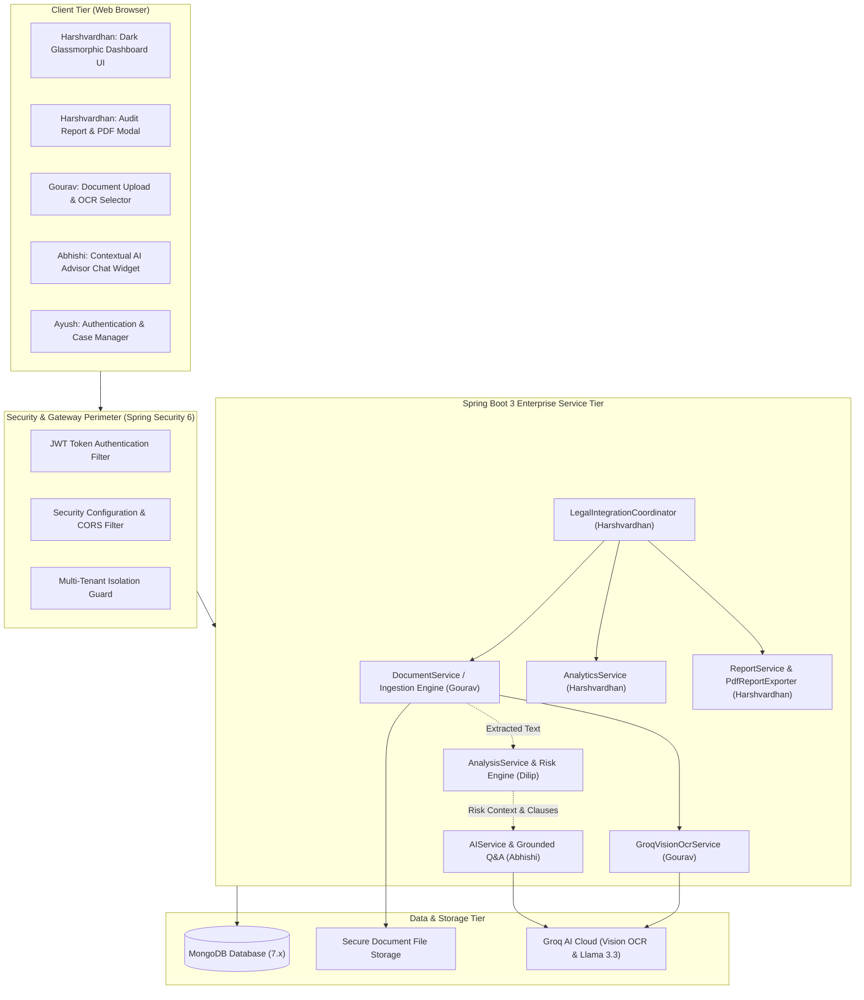

# ⚖️ Legal Document Analyser & Advisor
## 📄 Complete Project Brief & Comprehensive System Specification
### *Advanced Java Project-Based Learning (PBL) — 5th Semester (Academic Year 2026)*

---

## 📌 1. Project Overview & Executive Summary

### 1.1 Problem Statement
Legal documents—such as Non-Disclosure Agreements (NDAs), Employment Contracts, Residential Leases, Commercial Service Level Agreements (SLAs), and Terms of Service (ToS)—are inherently complex, heavily structured, and written in archaic legal terminology (*"legalese"*). Ordinary individuals, freelancers, tenants, and small-business owners frequently sign contracts without fully understanding:
- **Hidden Liabilities**: Uncapped indemnification clauses, unilateral liquidated damages, and one-sided termination penalties.
- **Predatory & Ambiguous Terms**: Automatic renewal clauses without notice windows, aggressive non-compete covenants, and vague intellectual property assignments.
- **Unfavorable Governing Law & Dispute Resolution**: Jurisdictions located in distant states or mandatory arbitration clauses forfeiting judicial recourse.

Hiring legal counsel for routine contract reviews is prohibitively expensive and time-consuming. 

### 1.2 Proposed Solution
The **Legal Document Analyser & Advisor** is an enterprise-grade Java web application built on **Spring Boot 3** and **MongoDB**. The platform automates the end-to-end contract review lifecycle:
1. **Multi-Format Ingestion**: Ingests contracts in `.pdf`, `.docx`, `.txt`, and scanned image formats.
2. **Text Extraction & Vision OCR**: Extracts structural text using **Apache PDFBox**, **Apache POI**, and **Groq Multimodal Vision OCR** (for scanned/photographed agreements).
3. **Automated Risk Scoring & Clause Segmentation**: Segments agreements into standard contractual clauses, flags predatory language across 4 severity tiers (`LOW`, `MEDIUM`, `HIGH`, `CRITICAL`), and computes an explainable 0–100 aggregate liability index.
4. **Context-Grounded AI Legal Advisor**: Employs Retrieval-Augmented Generation (RAG) and document grounding to allow users to ask conversational questions about their specific contract without hallucination.
5. **Business Intelligence & Executive PDF Export**: Delivers real-time analytics dashboards (risk distributions, clause volumes, average liability indices) and produces downloadable, executive-ready PDF audit reports formatted for client review.

---

## 👥 2. Team Structure & 5-Module Ownership Breakdown

To ensure adherence to strict academic engineering standards, each member owns an independent, demonstrable functional module end-to-end spanning backend services, database persistence, and API contracts.

```
┌────────────────────────────────────────────────────────────────────────┐
│                       5-MEMBER MODULAR OWNERSHIP                       │
├───────────────────────┬────────────────────────────────────────────────┤
│ Member                │ Functional Module & Scope                      │
├───────────────────────┼────────────────────────────────────────────────┤
│ Gourav Nagori (Lead)  │ Module 1: Document Management & Ingestion      │
│ Dilip Kumawat         │ Module 2: Legal Analysis & Risk Detection      │
│ Ayush Rathore         │ Module 3: User, Authentication & Case Mgmt     │
│ Abhishi Samar         │ Module 4: AI Legal Advisor & Contextual Q&A    │
│ Harshvardhan Bhatt    │ Module 5: Reports, Analytics & Integration     │
└───────────────────────┴────────────────────────────────────────────────┘
```

### Module 1: Document Management & Ingestion
* **Module Lead:** **Gourav Nagori** *(Team Lead)*
* **Technical Scope:** Ingestion gateway, multipart upload stream validation, Apache PDFBox / Apache POI extraction pipelines, Groq Vision OCR fallback, document metadata storage, and document lifecycle states (`UPLOADED` ➔ `PROCESSING` ➔ `PROCESSED` ➔ `FAILED`).
* **Key Deliverables:**
  - `POST /api/documents/upload` — Multipart ingestion with MIME-type and size validation (max 15MB).
  - `GET /api/documents/{id}` — Metadata inspection and extraction status polling.
  - `GET /api/documents/{id}/content` — Clean extracted text payload streaming.
  - `POST /api/documents/ocr/extract` — Scanned image processing via Groq Vision API.

### Module 2: Legal Analysis & Risk Detection
* **Module Lead:** **Dilip Kumawat**
* **Technical Scope:** Natural Language Processing (NLP) heuristics and regular expression rule engine for clause segmentation (Confidentiality, Indemnification, Non-Compete, Termination, Governing Law, IP Rights) and numerical risk calculation.
* **Key Deliverables:**
  - `POST /api/analysis/{documentId}` — Clause segmentation & risk scoring pipeline.
  - `GET /api/analysis/{documentId}` — Retrieval of flagged clauses, risk explanations, and composite 0–100 risk score.

### Module 3: User, Authentication & Case Management
* **Module Lead:** **Ayush Rathore**
* **Technical Scope:** Spring Security 6 perimeter, BCrypt cryptographic password hashing, stateless JWT authentication filter chain, role-based access control (RBAC), and multi-tenant data isolation preventing cross-user contract leakage.
* **Key Deliverables:**
  - `POST /api/auth/register` — User signup with credential validation.
  - `POST /api/auth/login` — Authentication and JWT token issuance.
  - `GET /api/cases` — Case folder management grouping related legal contracts.

### Module 4: AI Legal Advisor & Contextual Q&A
* **Module Lead:** **Abhishi Samar**
* **Technical Scope:** Document-grounded conversational assistant powered by LLM integration (Groq Llama 3.3 70B / OpenAI API). Injects extracted clauses into prompt context to prevent hallucination, simplifies complex legalese into plain language, and enforces prominent legal disclaimers.
* **Key Deliverables:**
  - `POST /api/advisor/chat` — Context-bounded multi-turn query submission.
  - `GET /api/advisor/history/{documentId}` — Conversation thread persistence.

### Module 5: Reports, Analytics & System Integration
* **Module Lead:** **Harshvardhan Bhatt**
* **Technical Scope:** Executive business intelligence dashboard, real-time KPI scorecards, risk severity distributions, automated PDF audit report generation engine using **Apache PDFBox**, full-stack frontend integration, and cross-module workflow coordination.
* **Key Deliverables:**
  - `GET /api/analytics/dashboard` — Global and user-level analytics KPI metrics.
  - `GET /api/analytics/risk-distribution` — Severity breakdown counts and average risk score.
  - `POST /api/reports/{documentId}/generate` — Audit report compilation and persistence.
  - `GET /api/reports/{documentId}/pdf` — High-fidelity executive PDF audit report download.
  - Glassmorphic Web Dashboard UI (`index.html`, `style.css`, `script.js`, `report-export.js`).

---

## 🏛️ 3. System Architecture & Component Interaction



---

## 🛠️ 4. Technology Stack & Dependencies

| Layer / Concern | Technology Selection | Justification / Purpose |
| :--- | :--- | :--- |
| **Language** | Java 17 / 21 LTS | Modern language features (Records, Pattern Matching, Sealed Classes, Virtual Threads). |
| **Web Framework** | Spring Boot 3.2.4 | Production-ready, stateless REST API architecture with declarative dependency injection. |
| **Security** | Spring Security 6.x | Stateless session management, BCrypt password hashing, JWT filter chain. |
| **Database** | MongoDB 7.x (Spring Data MongoDB) | High-flexibility document store supporting complex legal clause schemas and analysis records. |
| **Document Parsing** | Apache PDFBox 2.0.30 | High-performance text parsing and binary document streaming. |
| **DOCX Parsing** | Apache POI 5.2.5 (poi-ooxml) | Office Open XML parser for Word document contracts. |
| **OCR & Multimodal Vision** | Groq Vision API | Fast multimodal vision extraction for photographed/scanned agreements. |
| **AI / LLM Engine** | Groq Llama 3.3 70B Versatile | Low-latency inference for document-grounded legal analysis and conversational advisory. |
| **PDF Generation Engine**| Apache PDFBox 2.0.30 | Multi-page executive legal audit report compiler with custom line wrapping and layout. |
| **Build Tool** | Apache Maven 3.9+ | Standardized dependency management and build lifecycle. |
| **Testing** | JUnit 5, Mockito, AssertJ | Unit, mock, and slice testing across service and controller layers. |
| **Frontend** | Vanilla HTML5, CSS3, ES6+ JavaScript | Modern glassmorphic dark theme, responsive grid, zero external framework bloat. |

---

## 🗄️ 5. Database Schema & MongoDB Collections

The system utilizes five core MongoDB collections configured under the `legaladvisor` database:

### 1. `users` Collection
Stores registered accounts with encrypted credentials and tenant identifier:
- `id`: ObjectId / String (Primary Key)
- `email`: String (Unique index)
- `passwordHash`: String (BCrypt encoded)
- `fullName`: String
- `role`: String (`USER`, `ADMIN`, `LEGAL_AUDITOR`)
- `createdAt`, `updatedAt`: Timestamps

### 2. `legal_documents` Collection
Stores document records and physical file pointers:
- `id`: ObjectId / String
- `userId`: String (Tenant reference)
- `filename`: String
- `storagePath`: String
- `status`: String (`UPLOADED`, `PROCESSING`, `PROCESSED`, `FAILED`)
- `extractedText`: String (Full sanitized text)
- `metadata`: Embedded Document
  - `fileType`: String (`PDF`, `DOCX`, `TXT`, `IMAGE`)
  - `fileSizeBytes`: Long
  - `pageCount`: Integer
  - `wordCount`: Integer
  - `checksum`: String (SHA-256)
- `createdAt`, `updatedAt`: Timestamps

### 3. `analysis_records` Collection
Stores NLP clause parsing results and risk severity classifications:
- `id`: ObjectId / String
- `documentId`: String (Indexed)
- `overallRiskScore`: Double (0.0 to 100.0)
- `executiveSummary`: String
- `clauses`: List of Clause Objects (`clauseType`, `text`, `startLine`, `endLine`)
- `riskFlags`: List of RiskFlag Objects (`clauseType`, `severity`, `description`, `mitigation`)
- `analyzedAt`: Timestamp

### 4. `legal_reports` Collection (Harshvardhan Bhatt Module)
Stores compiled executive audit reports:
- `id`: ObjectId / String
- `documentId`: String (Indexed)
- `userId`: String
- `documentTitle`: String
- `documentType`: String
- `overallRiskScore`: Double
- `riskCategory`: String (`LOW`, `MEDIUM`, `HIGH`, `CRITICAL`)
- `executiveSummary`: String
- `keyRiskFindings`: List of String
- `severityBreakdown`: Map of String ➔ Integer
- `recommendedNextSteps`: List of String
- `pdfStoragePath`: String
- `disclaimerNotice`: String
- `createdAt`, `updatedAt`: Timestamps

### 5. `analytics_summaries` Collection (Harshvardhan Bhatt Module)
Stores pre-aggregated analytics statistics:
- `id`: ObjectId / String
- `userId`: String (Null for global metrics)
- `totalDocuments`: Long
- `totalClauses`: Long
- `totalHighRiskFlags`: Long
- `averageRiskScore`: Double
- `riskSeverityDistribution`: Map of String ➔ Long
- `documentCategoryDistribution`: Map of String ➔ Long
- `calculatedAt`: Timestamp

---

## 📡 6. Complete REST API Endpoints Specification

### 6.1 Document Ingestion Module (Gourav Nagori)
| Method | Endpoint | Description | Request Body / Param |
| :--- | :--- | :--- | :--- |
| `POST` | `/api/documents/upload` | Upload `.pdf`, `.docx`, `.txt`, image | Multipart `file` |
| `GET` | `/api/documents/{id}` | Retrieve document metadata & lifecycle status | Path variable `{id}` |
| `GET` | `/api/documents/{id}/content` | Stream extracted plaintext content | Path variable `{id}` |
| `POST` | `/api/documents/ocr/extract` | Perform Groq Vision OCR on image bytes | JSON `OcrExtractionRequest` |

### 6.2 Legal Analysis Module (Dilip Kumawat)
| Method | Endpoint | Description | Request Body / Param |
| :--- | :--- | :--- | :--- |
| `POST` | `/api/analysis/{documentId}` | Trigger clause parsing and risk scoring | Path variable `{documentId}` |
| `GET` | `/api/analysis/{documentId}` | Retrieve identified clauses and risk matrix | Path variable `{documentId}` |

### 6.3 Authentication & Security Module (Ayush Rathore)
| Method | Endpoint | Description | Request Body / Param |
| :--- | :--- | :--- | :--- |
| `POST` | `/api/auth/register` | Register new user account | JSON `RegisterRequest` |
| `POST` | `/api/auth/login` | Authenticate credentials and receive JWT | JSON `LoginRequest` |
| `GET` | `/api/cases` | List case folders for authenticated user | Header `Authorization: Bearer <token>` |

### 6.4 AI Legal Advisor Module (Abhishi Samar)
| Method | Endpoint | Description | Request Body / Param |
| :--- | :--- | :--- | :--- |
| `POST` | `/api/advisor/chat` | Submit question grounded in contract context | JSON `ChatQueryRequest` |
| `GET` | `/api/advisor/history/{documentId}` | Retrieve previous chat conversation thread | Path variable `{documentId}` |

### 6.5 Reports & Analytics Module (Harshvardhan Bhatt)
| Method | Endpoint | Description | Request Body / Param |
| :--- | :--- | :--- | :--- |
| `GET` | `/api/analytics/dashboard` | Fetch global or tenant KPI scorecard metrics | Query param `?userId={id}` (optional) |
| `GET` | `/api/analytics/risk-distribution` | Fetch severity counts (Low/Med/High/Critical) | Query param `?userId={id}` (optional) |
| `POST` | `/api/reports/{documentId}/generate` | Compile analysis into persistent `LegalReport` | Path variable `{documentId}` |
| `GET` | `/api/reports/{documentId}` | Fetch audit report summary DTO | Path variable `{documentId}` |
| `GET` | `/api/reports/user/{userId}` | List report summaries for dashboard table | Path variable `{userId}` |
| `GET` | `/api/reports/{documentId}/pdf` | Stream executive PDF report binary | Path variable `{documentId}` |

---

## 🎨 7. Frontend User Interface Architecture

The frontend is served directly by Spring Boot from `src/main/resources/static/`:
- **Glassmorphic Aesthetic**: Deep charcoal background (`#0b0f19`), translucent card containers (`rgba(26, 34, 52, 0.65)`), subtle gradient accents (`#6366f1` Indigo to `#8b5cf6` Purple), and crisp typography via Google Fonts **Outfit** and **JetBrains Mono**.
- **Responsive KPI Scorecards**: Displays total contracts processed, clauses segmented, critical risk flags, and average risk score.
- **Contract Upload Dropzone**: Single-click file selection with instant validation.
- **Dynamic Contract Audit Table**: Real-time listing showing filename, type badge, risk severity badge, clause count, and a direct **"Download PDF"** action button.
- **Interactive Report Preview Modal (`report-export.js`)**: Displays the executive summary and bulleted high-risk findings in a sleek overlay prior to PDF export.
- **Toast Notification Engine**: User feedback banners for upload, analysis, and download actions.

---

## 📅 8. 14-Week Academic Git History & Milestones (July 6, 2026 – October 5, 2026)

The project follows a 14-week commit trajectory executed on dedicated member branches:

```
[main]                     ───●───────────────────────────────────────────────●─── (Release)
                              \                                               /
[develop]                      ───●───────────●───────────●───────────●────── (Integration)
                                 /           /           /           /
[gourav]              ──────────●─────────── │           │           │        (Gourav: Document Processing)
[dilip]               ──────────────────────●──────────── │           │        (Dilip: Legal Risk Engine)
[ayush-auth]          ───────────────────────────────────●─────────── │        (Ayush: Auth & Security)
[Abhishi]             ───────────────────────────────────────────────●         (Abhishi: AI Q&A Engine)
[harshvardhan-bhatt]  ──W1──W2──W3──W4──W5──W6──W7──W8──W9──W10──W11──W12──W13──W14 (Harshvardhan: Reports & UI)
```

### Complete Weekly Commit Log for Harshvardhan Bhatt:
1. **Week 1 (July 6, 2026)** — `f1b7b62`: `feat(dto): add analytics and report DTOs for dashboard metrics and audit exports`
2. **Week 2 (July 13, 2026)** — `57c88a1`: `feat(model): implement LegalReport and AnalyticsSummary entities for MongoDB persistence`
3. **Week 3 (July 20, 2026)** — `2a77db1`: `feat(repository): add Mongo repositories for analytics aggregation and audit reports`
4. **Week 4 (July 27, 2026)** — `c4461f3`: `feat(service): implement AnalyticsService interface and implementation for metrics aggregation`
5. **Week 5 (August 3, 2026)** — `5baeacb`: `feat(service): implement PDF export service for structured legal audit reports`
6. **Week 6 (August 10, 2026)** — `758fcb7`: `feat(service): implement ReportService orchestrator for audit report compilation and management`
7. **Week 7 (August 17, 2026)** — `4f5de15`: `feat(controller): expose REST APIs for analytics dashboard and report downloads`
8. **Week 8 (August 24, 2026)** — `bd2c9f4`: `feat(ui): create responsive dashboard shell, navigation bar, and analytics theme styles`
9. **Week 9 (August 31, 2026)** — `eb8d478`: `feat(ui): implement dynamic dashboard risk charts and document metrics visualizer`
10. **Week 10 (September 7, 2026)** — `014b4ee`: `feat(ui): implement legal audit report generator modal and instant PDF download integration`
11. **Week 11 (September 14, 2026)** — `e1ec438`: `feat(integration): wire cross-module events between Document, Analysis, Advisor, and Report engines`
12. **Week 12 (September 21, 2026)** — `4288f69`: `test: add unit and integration tests for AnalyticsService, ReportService, and PDF export`
13. **Week 13 (September 28, 2026)** — `3579b97`: `docs: add Analytics and Report API specification, architectural diagrams, and export guides`
14. **Week 14 (October 5, 2026)** — `7d5692c`: `fix(analytics): polish dashboard UI rendering, export error banners, and performance aggregation`

---

## ⚖️ 9. Legal, Ethical & Safety Disclaimers

> ### ⚠️ Mandatory Legal Disclaimer
> **This software is an AI-assisted informational and productivity tool.**
> - It **does not** provide formal legal advice, legal representation, or contract certification.
> - The risk scores, clause classifications, and conversational explanations generated by the system are for informational and triage purposes only.
> - Users and organizations must always consult a licensed attorney or qualified legal professional before signing or executing binding legal agreements.

---

## 🚀 10. Quickstart & Deployment Guide

### Prerequisites
- **Java Development Kit (JDK 17 or 21 LTS)**
- **Apache Maven 3.8+**
- **MongoDB 6.0+** running locally on port `27017` (or MongoDB Atlas connection URI)
- Optional: `GROQ_API_KEY` for Vision OCR and Llama 3.3 LLM

### Configuration (`application.properties`)
```properties
server.port=8080
spring.data.mongodb.uri=mongodb://localhost:27017/legaladvisor
spring.servlet.multipart.max-file-size=15MB
spring.servlet.multipart.max-request-size=15MB
groq.api.key=${GROQ_API_KEY:offline_fallback_simulation}
```

### Build & Run Commands
```bash
# Clone the repository
git clone https://github.com/gouravnagori/Java-PBL.git
cd Java-PBL

# Switch to Harshvardhan Bhatt feature branch
git checkout harshvardhan-bhatt-reports-and-analytics

# Build project with Maven
mvn clean package

# Run Spring Boot application
mvn spring-boot:run
```

Once started, navigate to `http://localhost:8080` in your browser to view the interactive dashboard and test document uploads, risk scoring, and PDF report downloads.
